# Manual de usuario de CuidaRed

**Versión 1.0.0** · Para coordinadores y voluntarios · © 2026 Equipo CuidaRed – INTEC. Todos los derechos reservados.

> CuidaRed ayuda a organizar el acompañamiento de personas mayores. **No sustituye servicios médicos, instituciones públicas ni organismos de emergencia.** En una emergencia llama al **9-1-1**.

Este manual explica, paso a paso y sin tecnicismos, las tareas más comunes. Dentro de la aplicación también encontrarás ayuda: el botón **?** junto a muchos campos explica qué escribir, y la sección **Ayuda** (en *Mi perfil* o en *Más*) resume todo esto.

---

## Contenido

1. [Antes de empezar](#1-antes-de-empezar)
2. [Entrar a CuidaRed](#2-entrar-a-cuidared)
3. [La pantalla, parte por parte](#3-la-pantalla-parte-por-parte)
4. [Voluntario: el día a día en campo](#4-voluntario-el-día-a-día-en-campo)
5. [Trabajar sin internet](#5-trabajar-sin-internet)
6. [Coordinador: supervisar el seguimiento](#6-coordinador-supervisar-el-seguimiento)
7. [Colores y formas del nivel de riesgo](#7-colores-y-formas-del-nivel-de-riesgo)
8. [Privacidad y buen uso de la información](#8-privacidad-y-buen-uso-de-la-información)
9. [Preguntas frecuentes](#9-preguntas-frecuentes)

---

## 1. Antes de empezar

- **Qué necesitas:** un teléfono (o computadora) con un navegador moderno: Chrome, Safari, Firefox o Edge.
- **Instalarla como app (recomendado):** abre CuidaRed en el navegador del teléfono y elige *«Agregar a pantalla de inicio»* (Chrome: menú ⋮ → *Instalar aplicación*; Safari: botón *Compartir* → *Agregar a inicio*). Así se abre como cualquier app y funciona aunque no haya señal.
- **Tu cuenta:** la crea el administrador de tu organización. Te dará tu **correo** y un **código de activación de 6 dígitos**. En la pantalla de inicio toca **«Activar mi cuenta»**, escribe el correo y el código, confirma tus datos y elige tu propia contraseña (mínimo 8 caracteres, con mayúscula, minúscula y número).

## 2. Entrar a CuidaRed

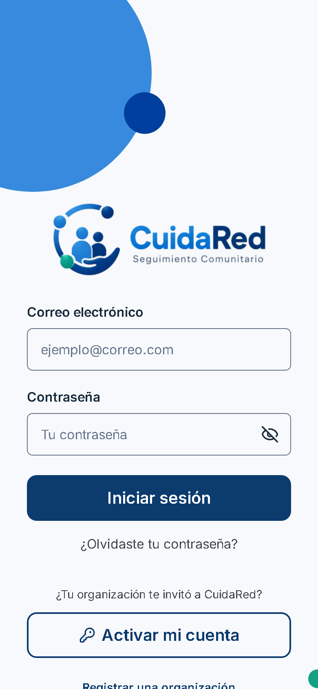

1. Escribe tu **correo** y tu **contraseña** y toca **Iniciar sesión**.
2. Si te equivocas varias veces seguidas, la cuenta se bloquea unos minutos por seguridad. Espera y vuelve a intentarlo.
3. **¿Olvidaste tu contraseña?** Toca *«¿Olvidaste tu contraseña?»*, escribe tu correo y usa el código que recibes para crear una nueva.
4. Por seguridad, la sesión se cierra sola tras **30 minutos sin usar la app**. Vuelve a entrar con tu correo y contraseña.

## 3. La pantalla, parte por parte

- **Barra superior (blanca):** a la izquierda el logo de CuidaRed; a la derecha tu **nombre y rol**. En el centro, el **indicador de conexión**:
  - ☁ verde **«En línea»**: todo se guarda al instante.
  - ☁ tachada ámbar **«Sin conexión»**: estás sin internet. Puedes seguir registrando visitas y necesidades (ver [sección 5](#5-trabajar-sin-internet)).
  - El número junto al indicador son los registros **pendientes de sincronizar**.
  - 🔔 (solo coordinadores y administradores de organización): **notificaciones** de alertas nuevas.
- **Barra azul:** el nombre de la pantalla y la flecha ← para volver.
- **Menú inferior (teléfono) o lateral (computadora):** las secciones principales de tu rol.

## 4. Voluntario: el día a día en campo

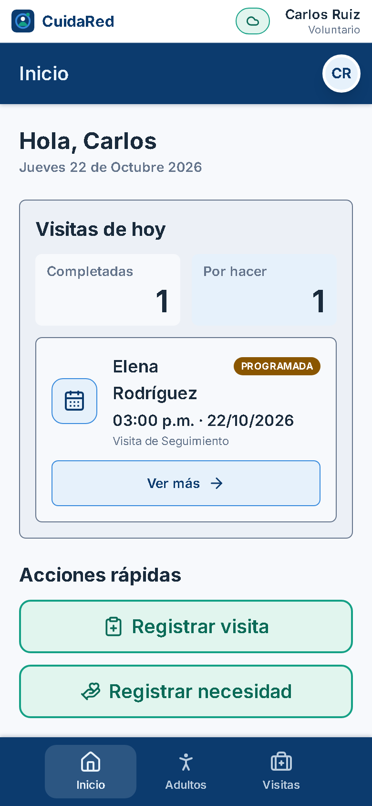

En **Inicio** ves tus visitas de hoy y botones rápidos para **Registrar visita** y **Registrar necesidad**.

### 4.1 Ver a los adultos mayores que acompañas

Toca **Adultos**. Solo aparecen las personas que tu coordinador te asignó. Cada tarjeta muestra el nivel de riesgo y cuántos días han pasado desde la última visita.

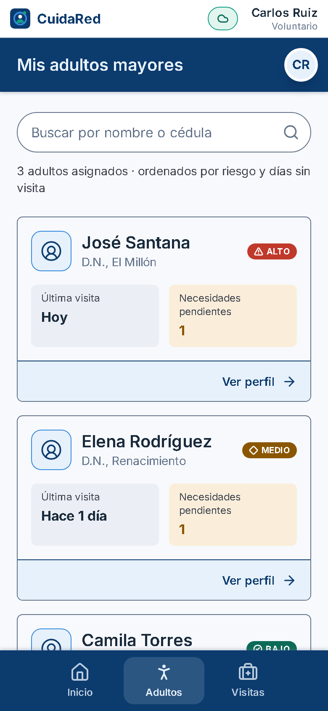

Al tocar una persona ves su perfil: datos de contacto, condición general, historial de visitas y necesidades.

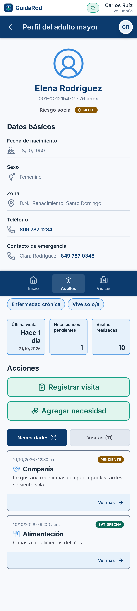

### 4.2 Registrar una visita (menos de 90 segundos)

1. Desde el perfil de la persona toca **Registrar visita** (o desde *Inicio*).
2. La **fecha**, la **hora** y el **responsable** (tú) ya vienen llenos. Cámbialos solo si la visita fue en otro momento.
3. Toca cómo encontraste a la persona: **Estable**, **Requiere atención** o **Situación crítica**.
4. Marca los **aspectos que verificaste** (alimentación, medicamentos, higiene, vivienda, ánimo, movilidad).
5. Escribe las **observaciones**. Puedes usar abreviaturas que se completan solas, por ejemplo: `sn` → *sin novedad*, `meds` → *medicamentos*, `pa` → *presión arterial*. Toca **?** para ver la lista.
6. Toca **Registrar visita**. Verás «Visita registrada correctamente».

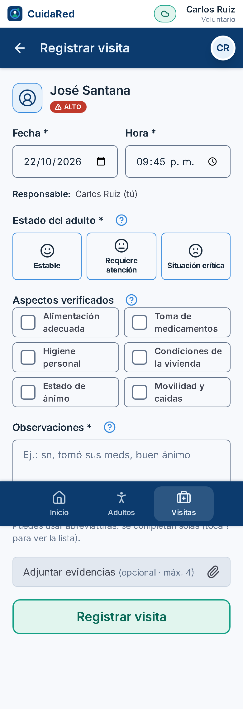

> Si marcas **Situación crítica**, queda registrado en la visita, pero no se crea una alerta automática: avisa al coordinador por tu canal habitual y, si hay peligro, llama al **9-1-1**.
> Si cierras la pantalla por error, lo que escribiste se conserva al volver.

### 4.3 Registrar una necesidad

1. Toca **Registrar necesidad** (al terminar una visita, en el perfil o en *Inicio*).
2. Elige la **categoría**: Medicamentos, Alimentación, Transporte, Compañía u Otros apoyos.
3. Describe la necesidad en pocas palabras y toca **Registrar necesidad**. Queda como **Pendiente**.

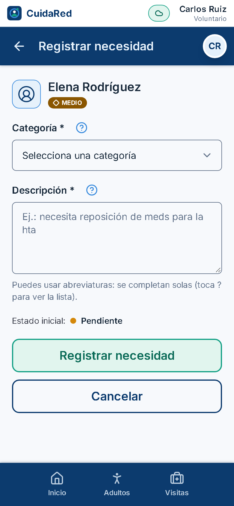

> Una necesidad de **Medicamentos** pendiente genera automáticamente una alerta de **Medicamento pendiente**, y una necesidad de otra categoría con prioridad **Alta**, una alerta de **Necesidad prioritaria**. Ambas aparecen en *Alertas* y el coordinador recibe una notificación.

### 4.4 Actualizar el estado de una necesidad

Abre la necesidad (desde el perfil de la persona) y elige el nuevo estado: **En proceso**, **Satisfecha** o **Inactiva**. Puedes agregar una nota. Abajo verás el **historial**: quién cambió el estado y cuándo.

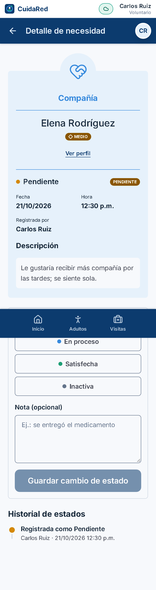

## 5. Trabajar sin internet

En campo muchas veces no hay señal. CuidaRed lo resuelve así:

1. Si se va la conexión, el indicador superior cambia a **«Sin conexión»**.
2. **Puedes seguir registrando visitas y necesidades** con normalidad. Al guardar verás *«Guardada en el dispositivo · Pendiente de sincronización»*.
3. Cuando vuelve la señal, CuidaRed **envía todo sola**, sin que hagas nada, y te avisa con un mensaje.
4. En **Conexión y sincronización** (toca el indicador superior) ves la lista de pendientes, el resultado del último envío y el espacio usado en el teléfono.

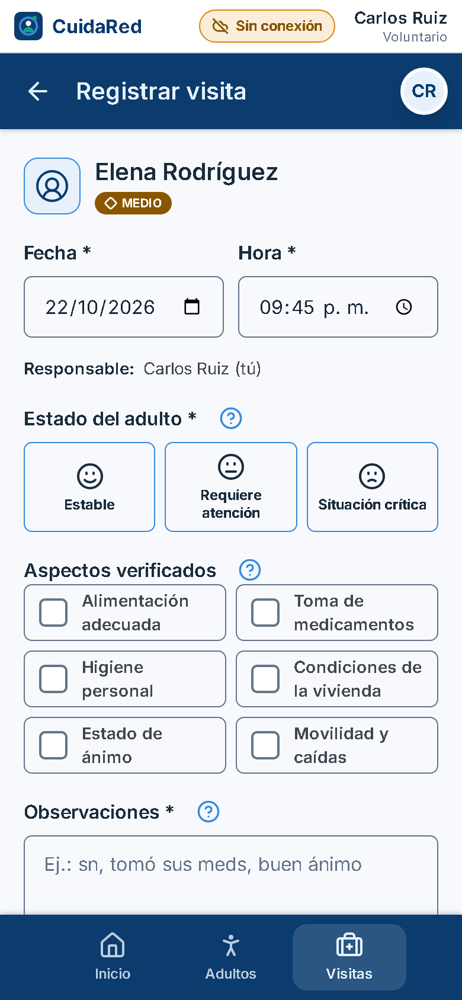

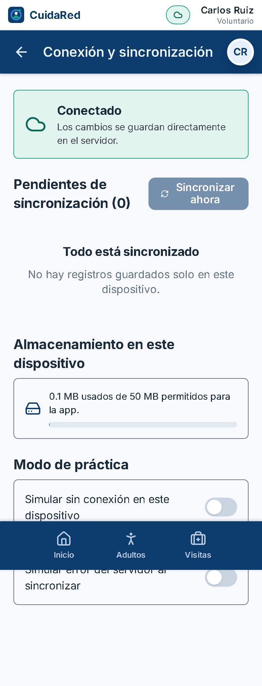

**Preguntas comunes**

- *¿Y si otra persona cambió lo mismo mientras yo estaba sin señal?* CuidaRed conserva **el cambio más reciente** (regla «la última escritura gana») y te informa cuál versión quedó.
- *¿Y si algo no se pudo enviar?* Queda guardado en tu teléfono y se reintenta solo. Si el error persiste (por ejemplo, el perfil fue desactivado), aparece el motivo y puedes descartarlo.
- *¿Puedo cerrar sesión con pendientes?* Sí: CuidaRed te avisa y los enviará cuando vuelvas a entrar **con tu misma cuenta**.
- Otras acciones (crear perfiles, programar visitas, gestionar alertas) **necesitan internet**; sus botones se desactivan y te explican por qué.
- *Para capacitaciones:* en *Conexión y sincronización* puedes activar **«Simular sin conexión»** sin apagar el Wi-Fi.

## 6. Coordinador: supervisar el seguimiento

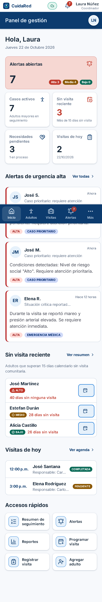

El **Inicio** del coordinador resume: casos activos, alertas abiertas por urgencia, personas que superan los días sin visita, necesidades pendientes y visitas de hoy.

### 6.1 Resumen de casos

En **Resumen** (Coordinador y Administrador de la organización) ves **todos los casos activos** de tu cuenta: adultos mayores activos con consentimiento vigente. Cada caso muestra su **prioridad** (alta, media o baja), su **estado de atención** y los datos que lo explican: alertas abiertas, necesidades activas y días sin visita. La prioridad combina alertas abiertas, riesgo, seguimiento y necesidades.

**Indicadores de arriba.** Cubren todos los casos activos y no cambian con los filtros:

- Casos activos, y cuántos tienen prioridad alta, media o baja.
- Adultos sin personal asignado. En Organización también se muestran los adultos que superaron el umbral de días sin visita.
- **Adultos prioritarios:** personas con al menos una alerta prioritaria abierta. Cada persona se cuenta una vez.
- **Alertas abiertas:** se cuentan una por una. Dos alertas de la misma persona suman dos alertas, pero un solo adulto prioritario.
- Necesidades activas (pendientes o en proceso).

**Estados de atención** (del más urgente al menos urgente):

- **Alerta pendiente:** tiene una alerta abierta que nadie ha empezado a atender.
- **Alerta en atención:** tiene alertas abiertas y todas ya están en atención.
- **Seguimiento vencido:** sin alertas abiertas, pero superó el límite de días sin visita.
- **Necesidades activas:** sin lo anterior, pero con necesidades pendientes o en proceso.
- **Al día:** sin alertas abiertas, sin necesidades activas y con visitas al día.

**Buscar, filtrar y ordenar**

1. Escribe al menos 2 letras en el buscador (nombre, sector o municipio).
2. Filtra por estado de atención, prioridad, riesgo, municipio, sector o personal asignado (con o sin personal, o una persona concreta).
3. Ordena por prioridad, estado de atención, última visita, nivel de riesgo o nombre. Toca **Orden** para invertir el sentido.
4. Toca **Quitar filtros** para volver a ver todos los casos.

La lista se muestra por páginas. Toca el nombre de un caso para abrir su expediente.

### 6.2 Atender alertas

CuidaRed crea las alertas **automáticamente** y genera **una alerta por cada causa**, no una por persona. Estos son los cuatro tipos:

| Alerta | Cuándo se crea | Prioridad |
|---|---|---|
| **Riesgo alto** | La persona tiene un factor de riesgo de nivel **Alto** vigente. Hay **una alerta por cada factor** | Alta |
| **Medicamento pendiente** | Hay una necesidad de **Medicamentos** pendiente. Hay **una alerta por cada necesidad** registrada | Alta |
| **Necesidad prioritaria** | Hay una necesidad pendiente de **otra categoría** con prioridad **Alta**. Se crea al registrarla o al subirle la prioridad | Alta |
| **Seguimiento familiar sin visita** | Solo en Organización. Se genera al superar **15 días calendario** desde la última visita completada o desde el alta. Puedes cambiar el umbral en *Días sin visita para generar alerta*. | Media |

Los tres primeros tipos forman los **casos prioritarios**. No existe una alerta de «Emergencia»: marcar **Situación crítica** en una visita queda registrado en la visita, pero no crea una alerta.

Cada alerta tiene uno de **tres estados**:

| Estado | Qué significa |
|---|---|
| **Pendiente** | Nadie ha empezado a atenderla |
| **En atención** | Alguien de la coordinación pulsó *Iniciar atención* |
| **Resuelta** | Se registró la acción tomada, o el sistema la cerró porque dejó de cumplirse su causa |

**Quién puede hacer qué**

- **Coordinador (Familia u Organización) y Administrador (Organización):** consultan las alertas, pueden **iniciar la atención** y **resolver**.
- **Cuidador:** consulta las alertas de las personas que tiene asignadas y puede **resolverlas**, pero no iniciar la atención.
- **Voluntario y Familiar:** no ven alertas.

**La pantalla Alertas** tiene tres bandejas:

- **Casos prioritarios:** las personas con alertas abiertas (pendientes o en atención) de riesgo alto, medicamento pendiente o necesidad prioritaria, agrupadas por persona con el número de alertas de cada una.
- **Alertas:** el listado completo, de la más reciente a la más antigua. Se filtra por **estado**, **tipo** y **adulto mayor**. Desde el perfil de una persona activa, el botón **Ver alertas de este adulto** abre este listado ya filtrado.
- **Notificaciones:** los avisos recibidos (solo para quienes los reciben, ver más abajo).

**Resolver una alerta**

1. Abre la alerta y revisa por qué se generó: la descripción y su **fuente** (factor de riesgo, necesidad registrada, visita de referencia o alta del expediente).
2. Si quieres dejar constancia de que ya la estás trabajando, toca **Iniciar atención** (solo coordinación).
3. Toca **Resolver alerta**, **escribe la acción que tomaste** (hasta 500 caracteres) y confirma. Quedan registradas la acción, la fecha y quién la atendió.

**Cierre automático.** Si desaparece la causa, la alerta se resuelve sola y lo indica: «La alerta se cerró automáticamente al dejar de cumplirse su causa». Ocurre cuando baja el nivel de riesgo, cuando la necesidad se atiende o baja de prioridad, o cuando hubo una visita completada; esta última se comprueba cada noche, a las 00:05 hora de República Dominicana. Si resuelves una alerta a mano, conserva su origen. Solo una nueva causa (otro factor de riesgo, otra necesidad o una nueva ventana sin visitas) crea una alerta nueva.

**Notificaciones.** Al crearse una alerta, reciben una notificación interna el **Coordinador** y, en una organización, el **Administrador** que tengan acceso al caso; en el 🔔 de la barra superior aparece el número de avisos sin leer. El texto es genérico («Hay una alerta de caso prioritario por revisar» o «Hay una alerta de seguimiento por revisar») y no incluye datos de la persona. Los avisos de casos prioritarios se pueden desactivar en la configuración de la cuenta (*Notificar casos prioritarios*). El Cuidador consulta sus alertas, pero **no recibe notificaciones** ni ve el 🔔. En *Alertas → Notificaciones* puedes activar los avisos del dispositivo para recibirlos aunque CuidaRed esté cerrado.

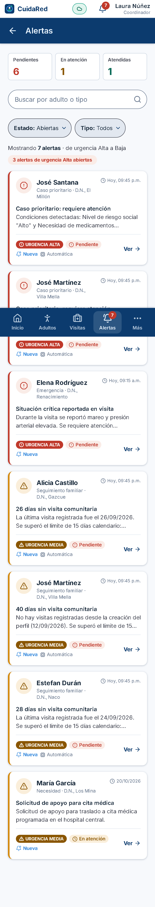

### 6.3 Registrar un perfil de adulto mayor

1. **Adultos → Nuevo perfil**.
2. **Paso 1, identificación:** nombre, apellido, cédula, fecha de nacimiento, sexo y teléfono (opcional).
3. **Paso 2, condición y riesgo:** zona, contacto de emergencia, autonomía, condiciones (casillas), **nivel de riesgo social** (obligatorio) y confirmación del **consentimiento informado**.
4. Toca **Guardar**. Si falta algo, el campo se marca en rojo con la explicación y lo que ya escribiste se conserva.

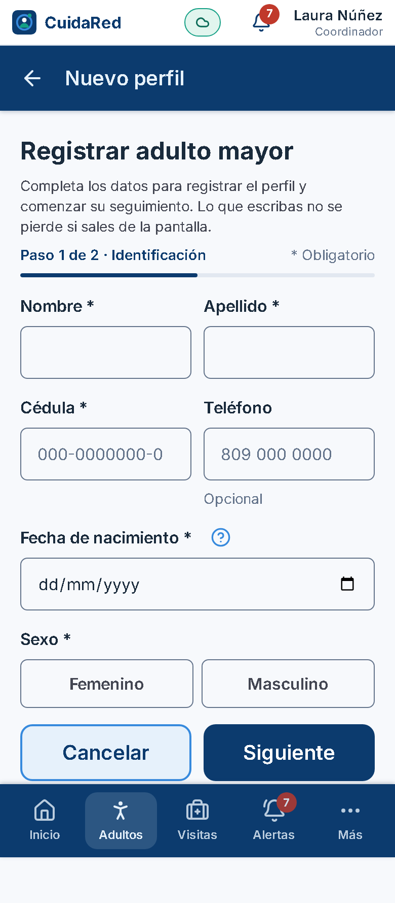

Desde el perfil puedes **editar** los datos, **asignar voluntarios**, hacer la **evaluación de riesgo** (calcula el nivel con preguntas sencillas) o **desactivar** el perfil.

### 6.4 Programar visitas

**Visitas → Programar visita**: elige la persona, el voluntario responsable, la fecha, la hora y notas para el voluntario. CuidaRed avisa si la fecha ya pasó o si el voluntario tiene otra visita a esa hora.

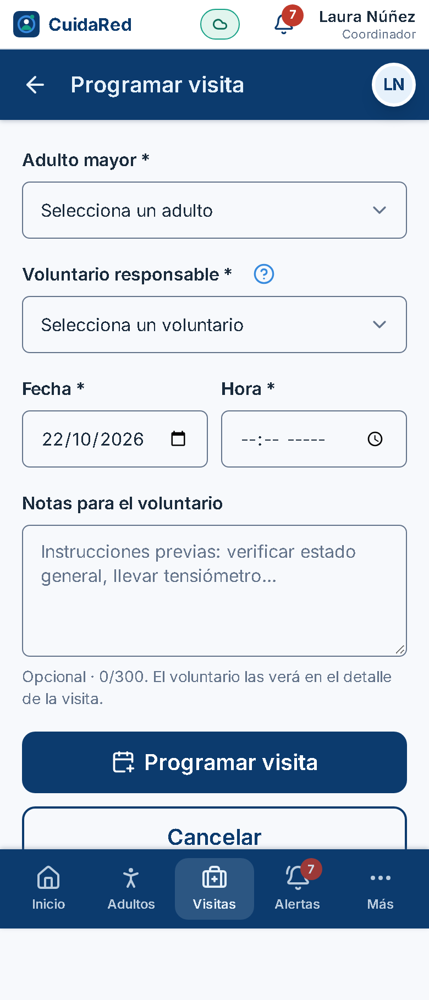

### 6.5 Reportes y estadísticas

En **Reportes** (Coordinador y Administrador de la organización) ves indicadores y gráficos de los adultos mayores de tu cuenta. Los reportes **no incluyen cédula, teléfono ni dirección**.

Para usar Reportes, tu plan debe incluir **métricas**. Si no lo incluye, la pantalla lo indica y no muestra datos. La prueba gratuita de una organización sí lo incluye; la de una familia, no.

**Tipos de reporte**

- **Adultos mayores registrados:** los dados de alta en el período.
- **Visitas realizadas:** incluye las visitas institucionales completadas y las muestra por separado. Solo las visitas con expediente suman atenciones a adultos. Los filtros de municipio, sector o riesgo se aplican a expedientes. Disponible solo en Organización.
- **Necesidades frecuentes y atendidas:** por categoría y con su estado actual.
- **Casos prioritarios:** alertas prioritarias del período y su estado actual.

**Cómo generar un reporte**

1. Elige el tipo de reporte.
2. Elige el **período**: todo el tiempo, este mes, últimos 3 meses, últimos 6 meses, este año o personalizado (desde / hasta). Si «hasta» es anterior a «desde», corrige el rango para consultar o exportar.
3. Si quieres, filtra por municipio, sector o riesgo. En *Necesidades*, también por categoría.
4. Revisa los indicadores, los gráficos y la tabla de datos. Cada gráfico tiene su tabla con los mismos números. Toca **Mostrar filas más** para ver el detalle completo. Los nombres abren su expediente.

Si el período no tiene datos, la pantalla lo dice. Prueba con otro período o quita algún filtro.

**Exportar**

- **Descargar CSV:** el archivo lo entrega el servidor y se abre en Excel.
- **Exportar PDF:** CuidaRed registra primero la exportación. Si no puede registrarla, no genera ningún archivo.
- **Exportar Excel** y **Análisis avanzado** (comparativo por sector y por municipio, y tendencias mensuales): solo si tu plan incluye **reportes avanzados**. La prueba gratuita no lo incluye.

Cada exportación queda en **Auditoría** con la acción **Exportación**. Exportar necesita Internet: sin conexión, los botones se desactivan y la pantalla te explica por qué.

### 6.6 Informe médico de un adulto mayor

El informe médico es un PDF que resume el expediente de una persona, para que lo interprete personal de salud. Lo pueden generar el **Coordinador** y el **Cuidador**; el Cuidador, solo de los adultos que tiene asignados. El Administrador no lo ve.

1. Abre el expediente del adulto mayor y ve a la sección de **seguimiento**.
2. Toca **Generar informe médico**. CuidaRed consulta la información en ese momento.
3. Revisa el informe en pantalla. Si necesitas una copia, toca **Descargar informe en PDF**.

El informe contiene:

- Identificación mínima: nombre, cédula, fecha de nacimiento, sexo, municipio y estado del expediente.
- Indicaciones médicas activas cuya fecha de inicio ya llegó y cuyo fin sigue vigente.
- Riesgo vigente e historial (hasta 15 registros).
- Las últimas 10 visitas realizadas, con sus observaciones.
- Quién lo generó y cuándo.
- Un aviso: CuidaRed **no es un diagnóstico médico**.

Si tu rol no puede ver alguna sección, el informe la omite y dice cuál y por qué.

Cada informe queda registrado en la auditoría. Generarlo necesita Internet. Contiene datos sensibles: compártelo solo con quien corresponda.

### 6.7 Suscripción y pagos de prueba

Desde el resumen de la cuenta, abre **Ver suscripción y pagos** para consultar el estado, los planes disponibles y el historial. Los roles autorizados conservan acceso a esta pantalla cuando termina la prueba o vence el plan.

Cada tarjeta muestra los beneficios y límites de un plan. Elige **Mensual** o **Anual** en la misma tarjeta. En Familia, las tarifas publicadas por Backoffice sustituyen a los precios de referencia y habilitan la contratación cuando Stripe Sandbox está disponible.

La pantalla consulta los valores vigentes al volver a la pestaña y se actualiza mientras permanece abierta. El cupo de cuidadores de Básico Familiar es inicialmente de cinco y Backoffice puede ajustarlo.

En una organización, **Operación Base** se contrata directamente cuando Backoffice publica la tarifa de la periodicidad elegida. Para **Gestión Comunitaria Avanzada**, selecciona el ciclo y usa **Solicitar cotización**. La tarjeta muestra el importe en USD y los cupos acordados de adultos mayores, integrantes del equipo, cuidadores y familiares cuando Backoffice los publica. Cada periodicidad tiene su propia cotización. Pulsa **Actualizar planes** para consultar la tarifa o cotización más reciente.

La persona titular puede contratar en **Stripe Sandbox** con datos de prueba. Al volver, CuidaRed revisa el estado mientras espera la confirmación. Durante esa espera, **Consultar estado del pago** permite consultar si el pago ya se refleja en el historial. Si saliste de Stripe con un pago todavía abierto, retómalo desde la tarjeta del plan para ver el precio y los cupos de ese intento.

La persona titular de una suscripción de prueba activa puede cambiar de plan o cancelar la renovación. Un plan más caro con la misma periodicidad se aplica cuando se confirma el cargo proporcional. Un plan de menor precio o una periodicidad distinta se aplica en el próximo corte. Al cancelar la renovación, el acceso se mantiene hasta el final del período pagado.

## 7. Colores y formas del nivel de riesgo

El riesgo se reconoce **por el color y por la forma**, sin necesidad de leer:

| Forma | Color | Nivel |
|---|---|---|
| ▲ triángulo | rojo | **Alto**: atención prioritaria |
| ◆ rombo | ámbar | **Medio**: reforzar visitas y red de apoyo |
| ● círculo | verde | **Bajo**: seguimiento habitual |

## 8. Privacidad y buen uso de la información

- Usa la información **solo para el acompañamiento** de la persona. No la compartas por otros medios (redes sociales, mensajería personal).
- Cada rol ve únicamente lo que necesita: el voluntario, solo a las personas asignadas; el familiar, solo a su familiar.
- Las acciones importantes quedan registradas (quién, qué y cuándo).
- No escribas diagnósticos médicos detallados: CuidaRed no es un expediente clínico.
- Si sospechas un acceso indebido o perdiste tu teléfono, **avisa de inmediato al administrador** de tu organización.

Más detalles en *Mi perfil → Política de privacidad* y *Términos de uso*.

## 9. Preguntas frecuentes

**No veo a una persona que visito.** Pide al coordinador que te la asigne.

**Me sale «Acceso no autorizado».** Esa función no corresponde a tu rol. Si crees que deberías tener acceso, habla con el administrador.

**Mi cuenta dice que no está activa.** El administrador la desactivó o aún no la activaste con tu código. Contacta a tu organización.

**¿Dónde cambio mi contraseña o mis datos?** En *Mi perfil* (toca tu nombre arriba a la derecha).

**¿Cómo veo la versión y los créditos?** *Mi perfil → Acerca de CuidaRed*.

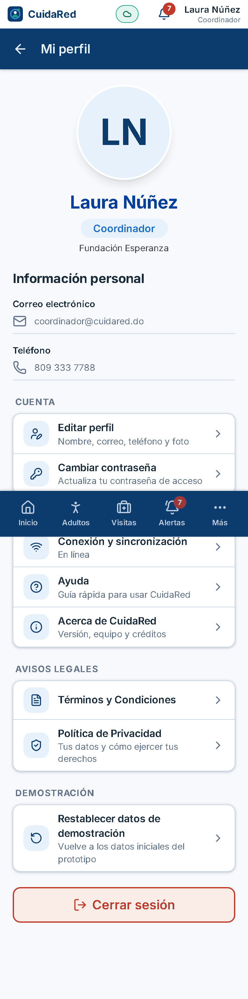
