# Manual de usuario de CuidaRed

**Versión 1.0.0** · Para coordinadores y voluntarios · © 2026 Equipo CuidaRed – INTEC. Todos los derechos reservados.

> CuidaRed ayuda a organizar el acompañamiento de personas mayores. **No sustituye servicios médicos, instituciones públicas ni organismos de emergencia.** En una emergencia llama al **9-1-1**.

Este manual explica, paso a paso y sin tecnicismos, las tareas más comunes. Dentro de la aplicación también encontrarás ayuda: el botón **?** junto a muchos campos explica qué escribir, y la sección **Ayuda** (en *Mi perfil* o en *Más*) resume todo esto.

---

## Contenido

1. [Antes de empezar](#1-antes-de-empezar)
2. [Entrar a CuidaRed](#2-entrar-a-cuidared)
3. [La pantalla, parte por parte](#3-la-pantalla-parte-por-parte)
4. [Voluntario: el día a día en campo](#4-voluntario-el-día-a-día-en-campo)
5. [Trabajar sin internet](#5-trabajar-sin-internet)
6. [Coordinador: supervisar el seguimiento](#6-coordinador-supervisar-el-seguimiento)
7. [Colores y formas del nivel de riesgo](#7-colores-y-formas-del-nivel-de-riesgo)
8. [Privacidad y buen uso de la información](#8-privacidad-y-buen-uso-de-la-información)
9. [Preguntas frecuentes](#9-preguntas-frecuentes)

---

## 1. Antes de empezar

- **Qué necesitas:** un teléfono (o computadora) con un navegador moderno: Chrome, Safari, Firefox o Edge.
- **Instalarla como app (recomendado):** abre CuidaRed en el navegador del teléfono y elige *«Agregar a pantalla de inicio»* (Chrome: menú ⋮ → *Instalar aplicación*; Safari: botón *Compartir* → *Agregar a inicio*). Así se abre como cualquier app y funciona aunque no haya señal.
- **Tu cuenta:** la crea el administrador de tu organización. Te dará tu **correo** y un **código de activación de 6 dígitos**. En la pantalla de inicio toca **«Activar mi cuenta»**, escribe el correo y el código, confirma tus datos y elige tu propia contraseña (mínimo 8 caracteres, con mayúscula, minúscula y número).

## 2. Entrar a CuidaRed

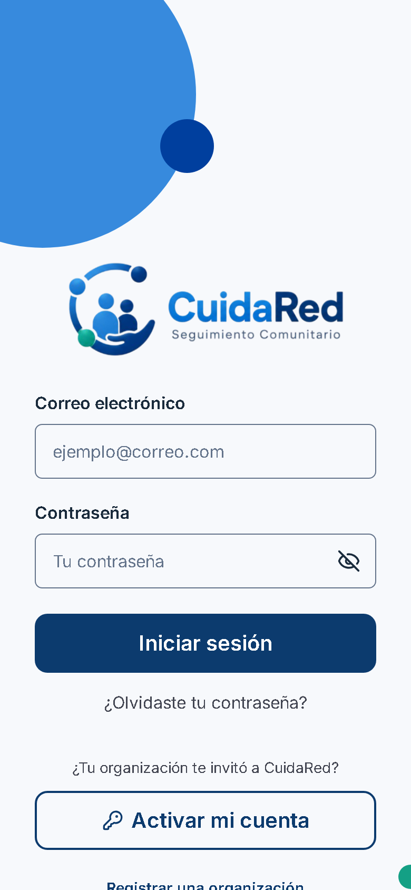

1. Escribe tu **correo** y tu **contraseña** y toca **Iniciar sesión**.
2. Si te equivocas varias veces seguidas, la cuenta se bloquea unos minutos por seguridad. Espera y vuelve a intentarlo.
3. **¿Olvidaste tu contraseña?** Toca *«¿Olvidaste tu contraseña?»*, escribe tu correo y usa el código que recibes para crear una nueva.
4. Por seguridad, la sesión se cierra sola tras **30 minutos sin usar la app**. Vuelve a entrar con tu correo y contraseña.

## 3. La pantalla, parte por parte

- **Barra superior (blanca):** a la izquierda el logo de CuidaRed; a la derecha tu **nombre y rol**. En el centro, el **indicador de conexión**:
  - ☁ verde **«En línea»**: todo se guarda al instante.
  - ☁ tachada ámbar **«Sin conexión»**: estás sin internet. Puedes seguir registrando visitas y necesidades (ver [sección 5](#5-trabajar-sin-internet)).
  - El número junto al indicador son los registros **pendientes de sincronizar**.
  - 🔔 (solo coordinadores): **notificaciones** de alertas nuevas.
- **Barra azul:** el nombre de la pantalla y la flecha ← para volver.
- **Menú inferior (teléfono) o lateral (computadora):** las secciones principales de tu rol.

## 4. Voluntario: el día a día en campo

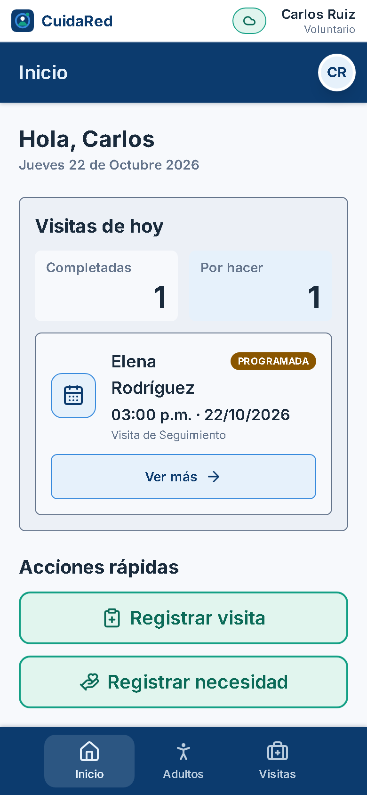

En **Inicio** ves tus visitas de hoy y botones rápidos para **Registrar visita** y **Registrar necesidad**.

### 4.1 Ver a los adultos mayores que acompañas

Toca **Adultos**. Solo aparecen las personas que tu coordinador te asignó. Cada tarjeta muestra el nivel de riesgo y cuántos días han pasado desde la última visita.

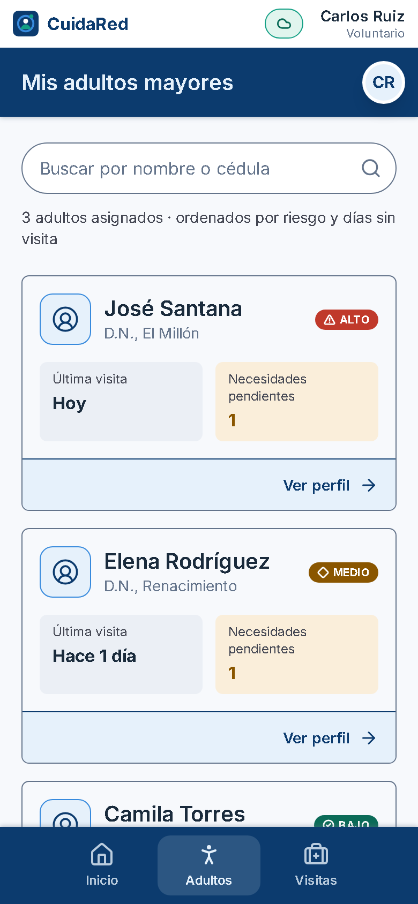

Al tocar una persona ves su perfil: datos de contacto, condición general, historial de visitas y necesidades.

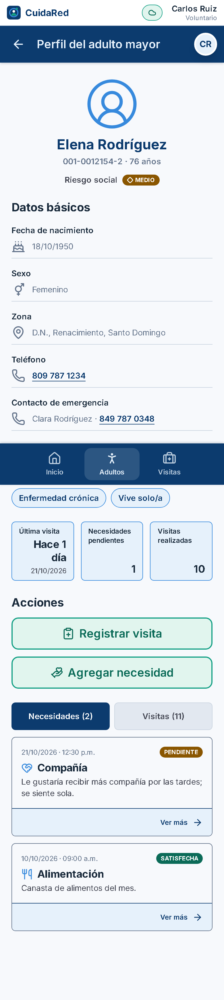

### 4.2 Registrar una visita (menos de 90 segundos)

1. Desde el perfil de la persona toca **Registrar visita** (o desde *Inicio*).
2. La **fecha**, la **hora** y el **responsable** (tú) ya vienen llenos. Cámbialos solo si la visita fue en otro momento.
3. Toca cómo encontraste a la persona: **Estable**, **Requiere atención** o **Situación crítica**.
4. Marca los **aspectos que verificaste** (alimentación, medicamentos, higiene, vivienda, ánimo, movilidad).
5. Escribe las **observaciones**. Puedes usar abreviaturas que se completan solas, por ejemplo: `sn` → *sin novedad*, `meds` → *medicamentos*, `pa` → *presión arterial*. Toca **?** para ver la lista.
6. Toca **Registrar visita**. Verás «Visita registrada correctamente».

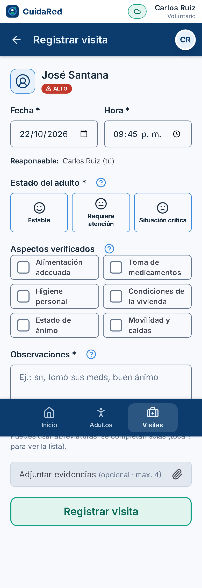

> Si marcas **Situación crítica**, el coordinador recibe una alerta de inmediato.
> Si cierras la pantalla por error, lo que escribiste se conserva al volver.

### 4.3 Registrar una necesidad

1. Toca **Registrar necesidad** (al terminar una visita, en el perfil o en *Inicio*).
2. Elige la **categoría**: Medicamentos, Alimentación, Transporte, Compañía u Otros apoyos.
3. Describe la necesidad en pocas palabras y toca **Registrar necesidad**. Queda como **Pendiente**.

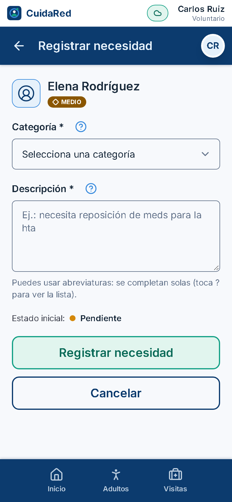

> Una necesidad de **Medicamentos** pendiente genera automáticamente una alerta de **caso prioritario** para el coordinador.

### 4.4 Actualizar el estado de una necesidad

Abre la necesidad (desde el perfil de la persona) y elige el nuevo estado: **En proceso**, **Satisfecha** o **Inactiva**. Puedes agregar una nota. Abajo verás el **historial**: quién cambió el estado y cuándo.

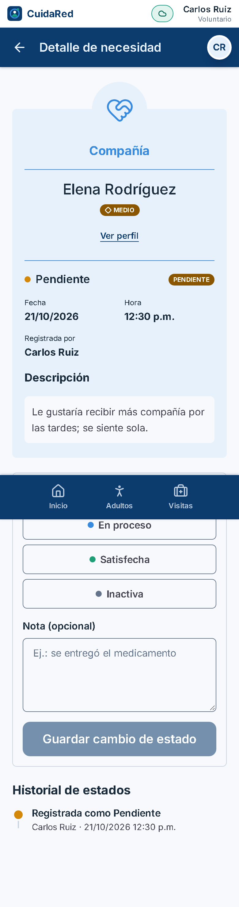

## 5. Trabajar sin internet

En campo muchas veces no hay señal. CuidaRed lo resuelve así:

1. Si se va la conexión, el indicador superior cambia a **«Sin conexión»**.
2. **Puedes seguir registrando visitas y necesidades** con normalidad. Al guardar verás *«Guardada en el dispositivo · Pendiente de sincronización»*.
3. Cuando vuelve la señal, CuidaRed **envía todo sola**, sin que hagas nada, y te avisa con un mensaje.
4. En **Conexión y sincronización** (toca el indicador superior) ves la lista de pendientes, el resultado del último envío y el espacio usado en el teléfono.

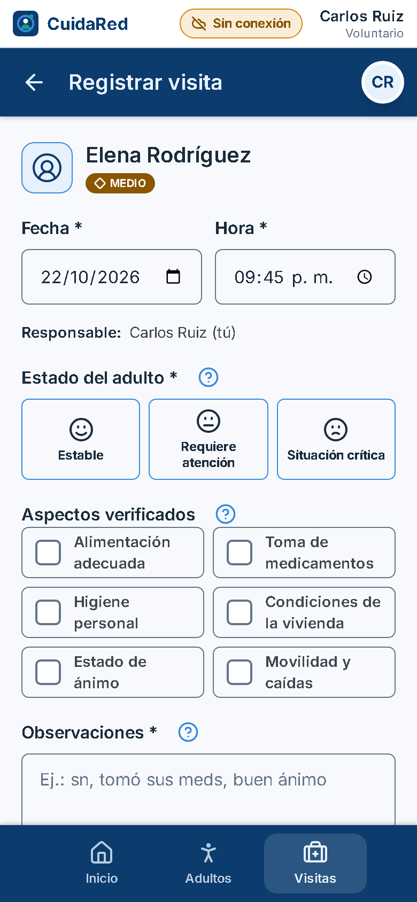

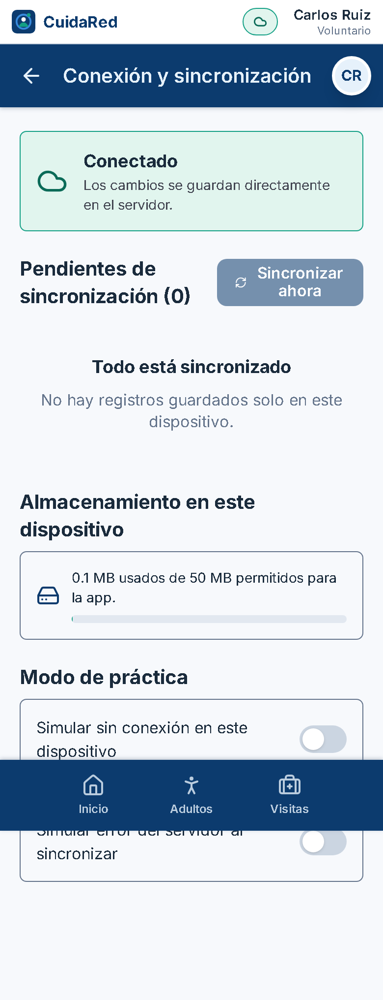

**Preguntas comunes**

- *¿Y si otra persona cambió lo mismo mientras yo estaba sin señal?* CuidaRed conserva **el cambio más reciente** (regla «la última escritura gana») y te informa cuál versión quedó.
- *¿Y si algo no se pudo enviar?* Queda guardado en tu teléfono y se reintenta solo. Si el error persiste (por ejemplo, el perfil fue desactivado), aparece el motivo y puedes descartarlo.
- *¿Puedo cerrar sesión con pendientes?* Sí: CuidaRed te avisa y los enviará cuando vuelvas a entrar **con tu misma cuenta**.
- Otras acciones (crear perfiles, programar visitas, gestionar alertas) **necesitan internet**; sus botones se desactivan y te explican por qué.
- *Para capacitaciones:* en *Conexión y sincronización* puedes activar **«Simular sin conexión»** sin apagar el Wi-Fi.

## 6. Coordinador: supervisar el seguimiento

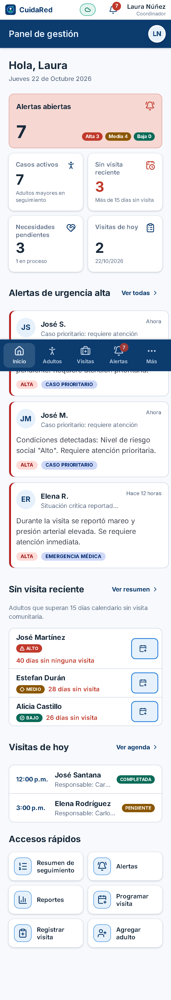

El **Inicio** del coordinador resume: casos activos, alertas abiertas por urgencia, personas que superan los días sin visita, necesidades pendientes y visitas de hoy.

### 6.1 Resumen de seguimiento

En **Más → Resumen de seguimiento** ves **todos los casos activos** ordenados por **prioridad** (alta, media, baja). Puedes ordenarlos por **estado de atención**, **fecha de la última visita** o **nivel de riesgo**, y agruparlos por estado. Se actualiza solo cuando algo cambia.

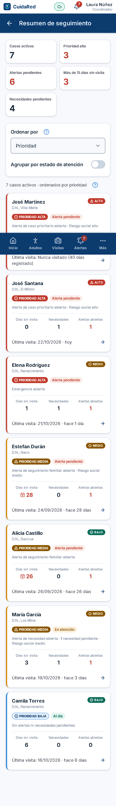

### 6.2 Atender alertas

CuidaRed crea alertas **automáticamente**:

| Alerta | Cuándo se crea | Urgencia |
|---|---|---|
| **Caso prioritario** | La persona tiene riesgo **Alto** o una necesidad de **Medicamentos** pendiente (una sola alerta aunque se cumplan ambas) | Alta |
| **Seguimiento familiar** | Pasan **más de 15 días** sin visita registrada (el administrador puede ajustar el número) | Media |
| **Emergencia** | Un voluntario reporta **Situación crítica** en una visita | Alta |

En **Alertas** se ordenan de mayor a menor urgencia. Abre una alerta, revisa por qué se generó, **escribe la acción que tomaste** y cambia su estado a **En atención** o **Atendida**. Todo queda en el historial de la alerta. Las alertas automáticas se cierran solas cuando desaparece la causa, por ejemplo al registrarse una visita.

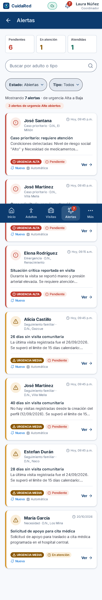

### 6.3 Registrar un perfil de adulto mayor

1. **Adultos → Nuevo perfil**.
2. **Paso 1, identificación:** nombre, apellido, cédula, fecha de nacimiento, sexo y teléfono (opcional).
3. **Paso 2, condición y riesgo:** zona, contacto de emergencia, autonomía, condiciones (casillas), **nivel de riesgo social** (obligatorio) y confirmación del **consentimiento informado**.
4. Toca **Guardar**. Si falta algo, el campo se marca en rojo con la explicación y lo que ya escribiste se conserva.

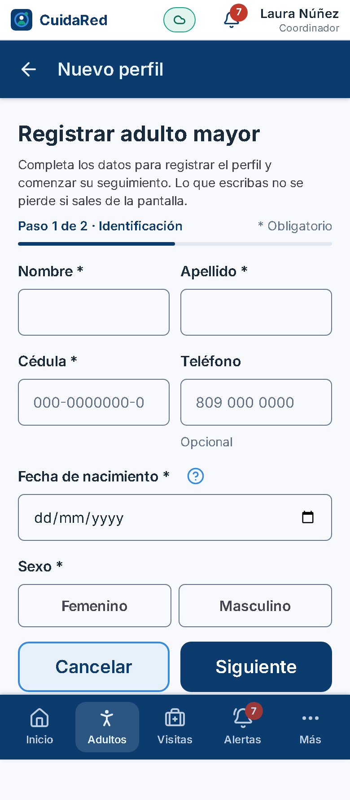

Desde el perfil puedes **editar** los datos, **asignar voluntarios**, hacer la **evaluación de riesgo** (calcula el nivel con preguntas sencillas) o **desactivar** el perfil.

### 6.4 Programar visitas

**Visitas → Programar visita**: elige la persona, el voluntario responsable, la fecha, la hora y notas para el voluntario. CuidaRed avisa si la fecha ya pasó o si el voluntario tiene otra visita a esa hora.

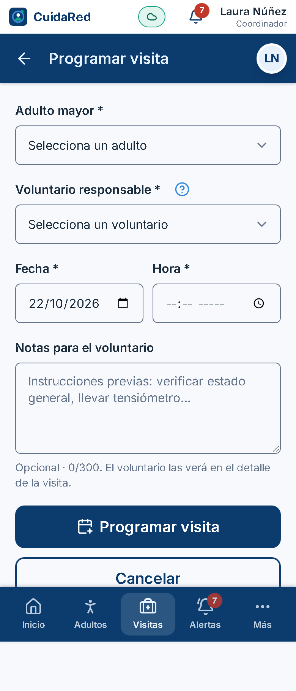

### 6.5 Reportes

En **Más → Reportes** elige el tipo de reporte: **adultos mayores registrados**, **visitas realizadas**, **necesidades frecuentes** o **casos prioritarios**. Puedes filtrar por fechas y por categoría. Toca **Exportar CSV** para abrirlo en Excel o **Imprimir / PDF**. Si no hay datos para los filtros elegidos, se indica claramente.

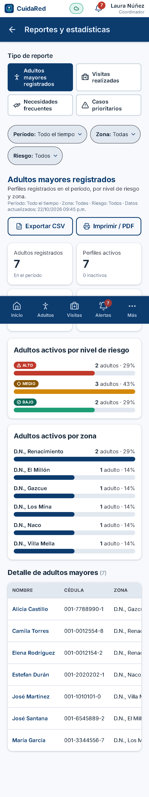

## 7. Colores y formas del nivel de riesgo

El riesgo se reconoce **por el color y por la forma**, sin necesidad de leer:

| Forma | Color | Nivel |
|---|---|---|
| ▲ triángulo | rojo | **Alto**: atención prioritaria |
| ◆ rombo | ámbar | **Medio**: reforzar visitas y red de apoyo |
| ● círculo | verde | **Bajo**: seguimiento habitual |

## 8. Privacidad y buen uso de la información

- Usa la información **solo para el acompañamiento** de la persona. No la compartas por otros medios (redes sociales, mensajería personal).
- Cada rol ve únicamente lo que necesita: el voluntario, solo a las personas asignadas; el familiar, solo a su familiar.
- Las acciones importantes quedan registradas (quién, qué y cuándo).
- No escribas diagnósticos médicos detallados: CuidaRed no es un expediente clínico.
- Si sospechas un acceso indebido o perdiste tu teléfono, **avisa de inmediato al administrador** de tu organización.

Más detalles en *Mi perfil → Política de privacidad* y *Términos de uso*.

## 9. Preguntas frecuentes

**No veo a una persona que visito.** Pide al coordinador que te la asigne.

**Me sale «Acceso no autorizado».** Esa función no corresponde a tu rol. Si crees que deberías tener acceso, habla con el administrador.

**Mi cuenta dice que no está activa.** El administrador la desactivó o aún no la activaste con tu código. Contacta a tu organización.

**¿Dónde cambio mi contraseña o mis datos?** En *Mi perfil* (toca tu nombre arriba a la derecha).

**¿Cómo veo la versión y los créditos?** *Mi perfil → Acerca de CuidaRed*.

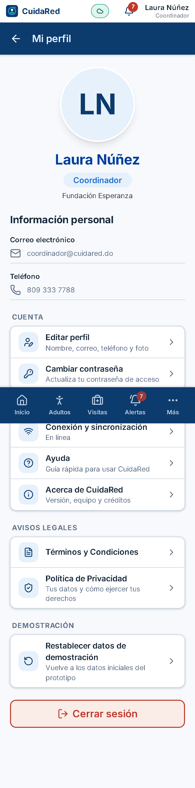
