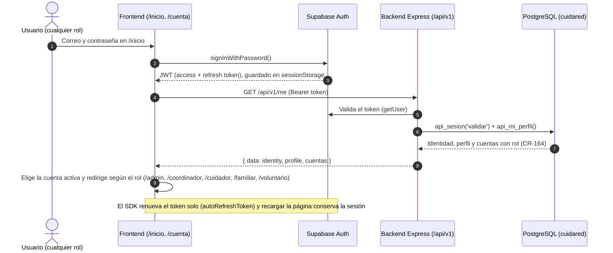
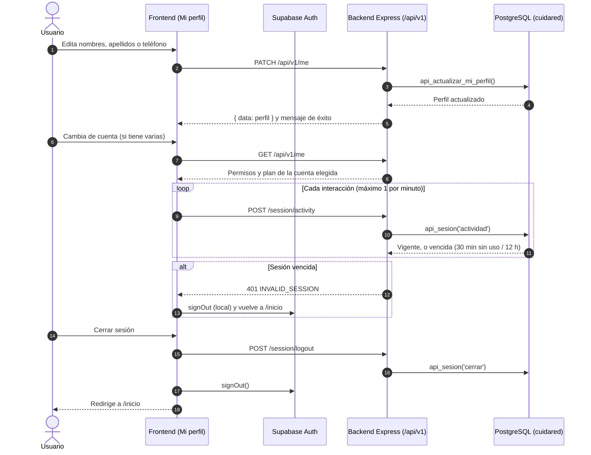

# Flujo de Login y Perfil (acceso conectado)

Diagramas de secuencia de los módulos de **Login** y **Perfil**, en el mismo formato que el de invitación de la tarea "Verificar Desarrollo FrontEnd". Reflejan el código actual: `src/features/access-real/*` (front) y `src/modules/access/*` del backend. Imágenes: `login.png` y `perfil.png` en esta carpeta.

## 1. Inicio de sesión y cuenta activa

## 2. Perfil, actividad y cierre de sesión

